Hello! I am Er Gouzi (2🐕)! This is a mixed group switch kit designed for ComfyUI workflow designers and users, enabling one-click control for ignoring or disabling different groups.

## 🐕 The icon can be dragged at any time using the mouse wheel (middle button)!!! 🐕

## Installation

First, open a command line terminal and navigate to your ComfyUI `custom_nodes` directory:

```cd /path/to/your/ComfyUI/custom_nodes```

Replace `/path/to/your/ComfyUI` with the actual path where your ComfyUI project is located.
Next, clone the ergouzi-kaiguan repository:

```git clone https://github.com/11dogzi/Comfyui-ergouzi-kaiguan.git```

## Update Log

2025/02/20: Corrected the wiring group switch: `true` for enabled / `false` for disabled.
2024/12/09: Added Desktop Pet Editor.
Play custom GIF animations during task execution.
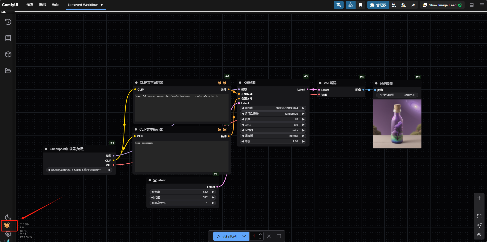  
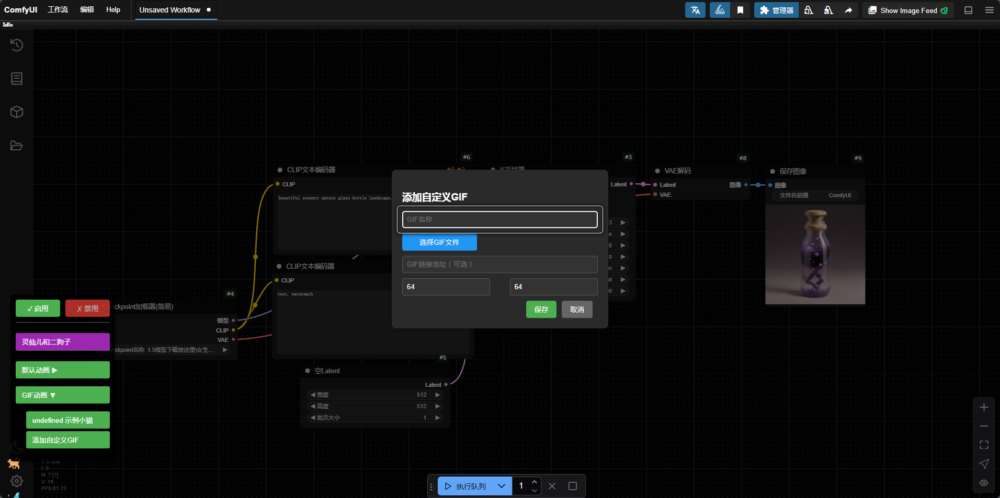  
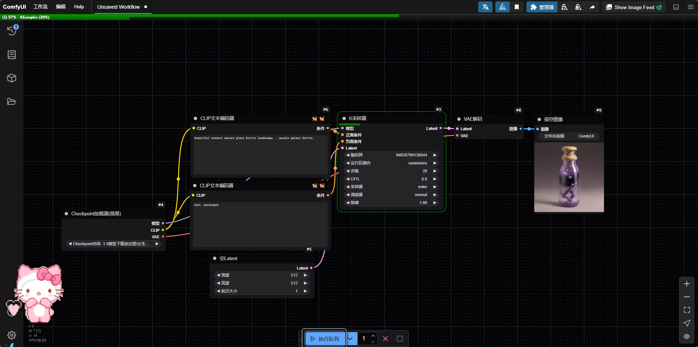  

2024/10/20: Added Task Manager node.
Node-based input allows you to execute or cancel the number of tasks required, with real-time updates of the current task count and completion count.
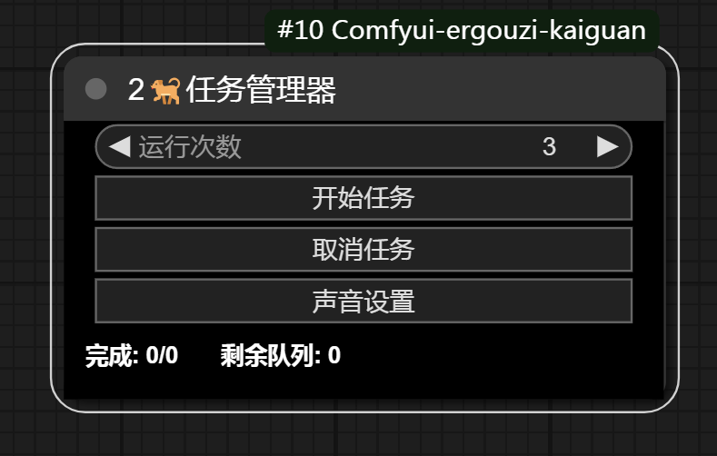     

Animated puppy during task execution (The puppy can be dragged by long-pressing the mouse wheel).
(If you do not need this feature, you can delete the `kaiguanj.js` file in `Comfyui-ergouzi-kaiguan\web`. If you are using a version from before February 2, 2025, you also need to delete `Comfyui\web\extensions\EG_KG`).
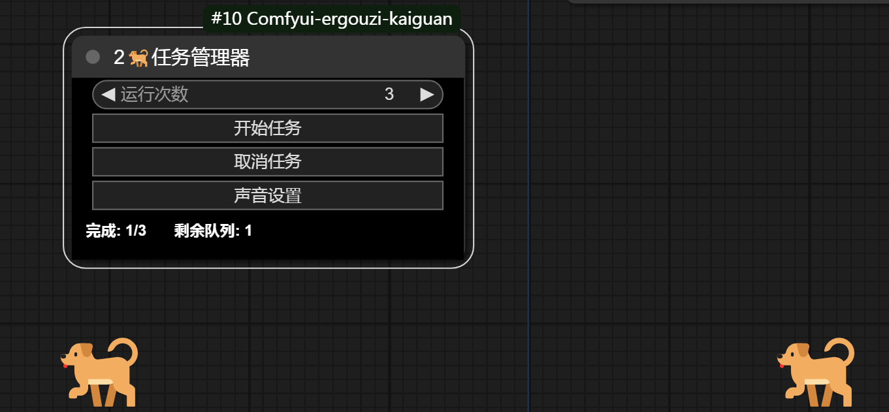      

You can click on the sound settings to configure the task completion notification sound.
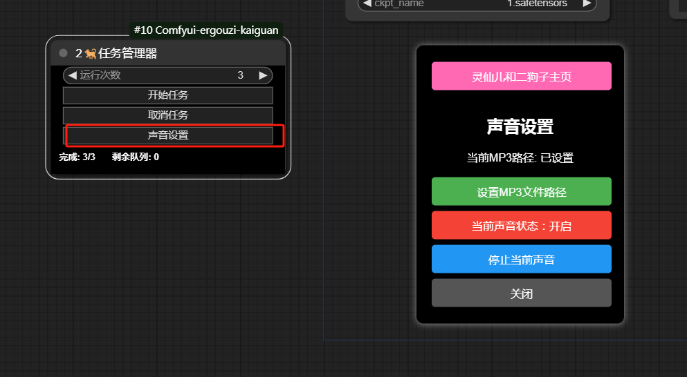      

## Video Tutorial
[Video Usage Tutorial](https://www.bilibili.com/video/BV1bT421677t/?vd_source=ab266c754171024c866a35bf8097094e)      

## Node Introduction

## Universal Switch Node: "Universal switch▶️"
Configure switches via the node's right-click menu to select switching schemes for global node groups. When multiple "Universal switch▶️" nodes are created, only the currently active node's settings will take effect to prevent conflicts.
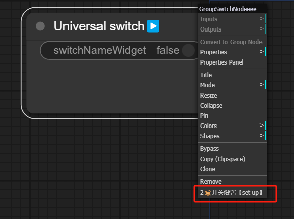    
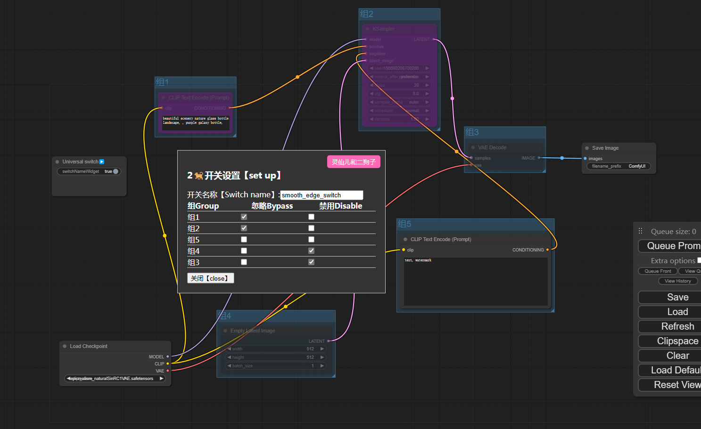    

## Wiring Switch Node: "All Ignore👁️‍🗨️▶️"
When this node is connected to "ALL🚫👁️‍🗨️", it ignores the group where the connected "ALL🚫👁️‍🗨️" is located. Multiple "ALL🚫👁️‍🗨️" can be connected to control multiple groups.
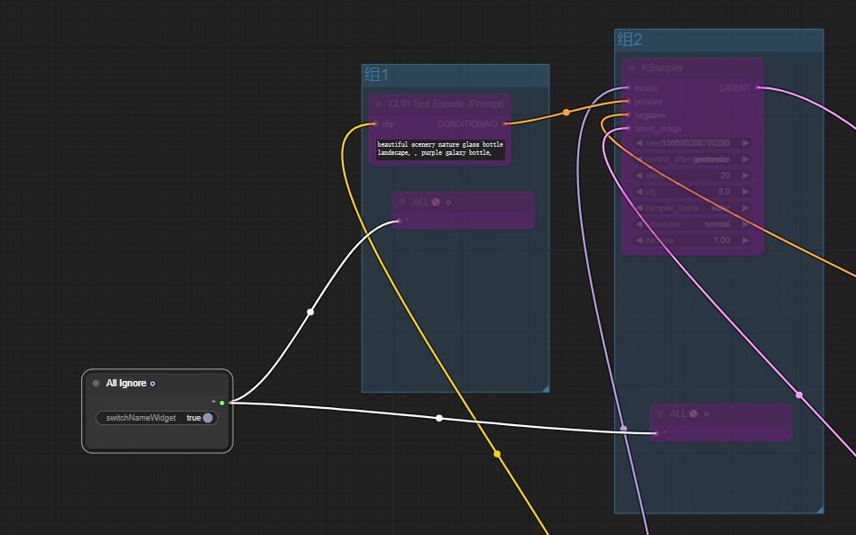       

## Wiring Switch Node: "All Disable🚫"
When this node is connected to "ALL🚫👁️‍🗨️", it disables the group where the connected "ALL🚫👁️‍🗨️" is located. Multiple "ALL🚫👁️‍🗨️" can be connected to control multiple groups.
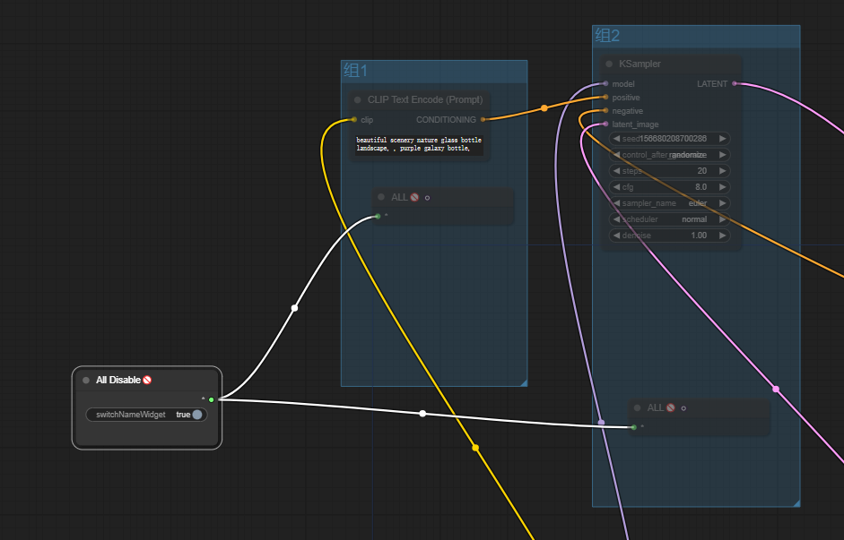    

## Hybrid Wiring Switch Node: "Hybrid switch🔃"
When this node is connected to "hulue🔃", it ignores the group where "hulue🔃" is located. When connected to "jin yong🔃", it disables the group where "jin yong🔃" is located. You can connect multiple "jin yong🔃" or "hulue🔃" for hybrid control.
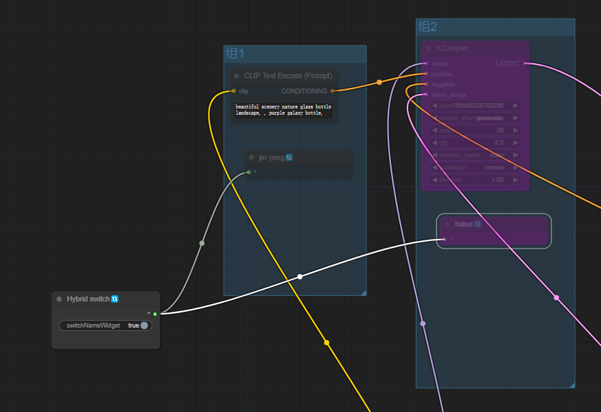     

## Switch Point Example:
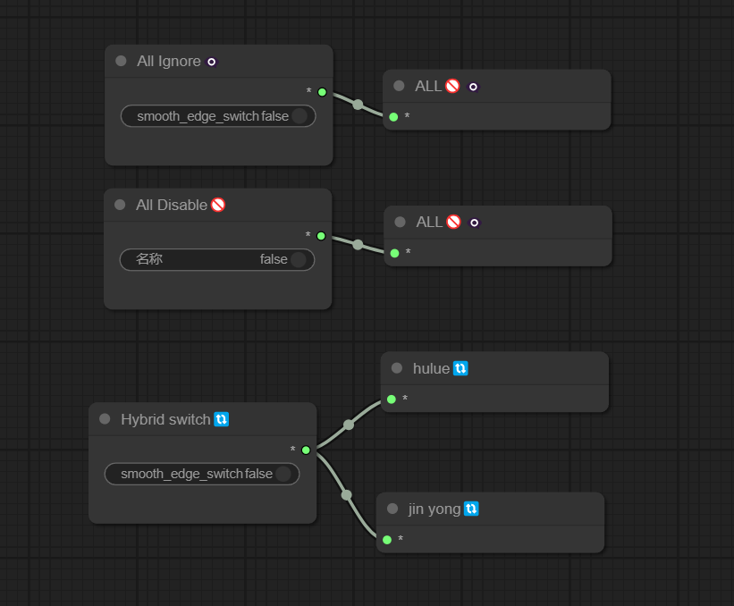   

## Switch Name Setting:
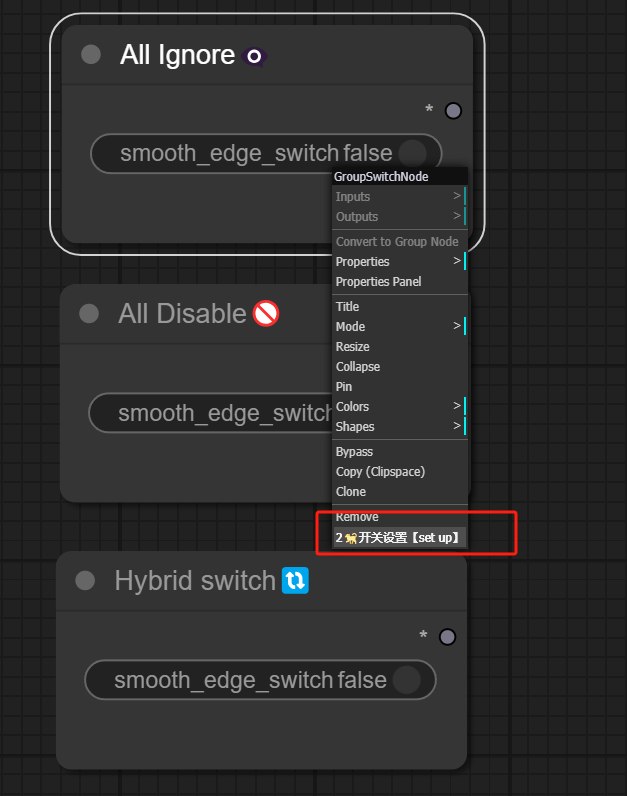    
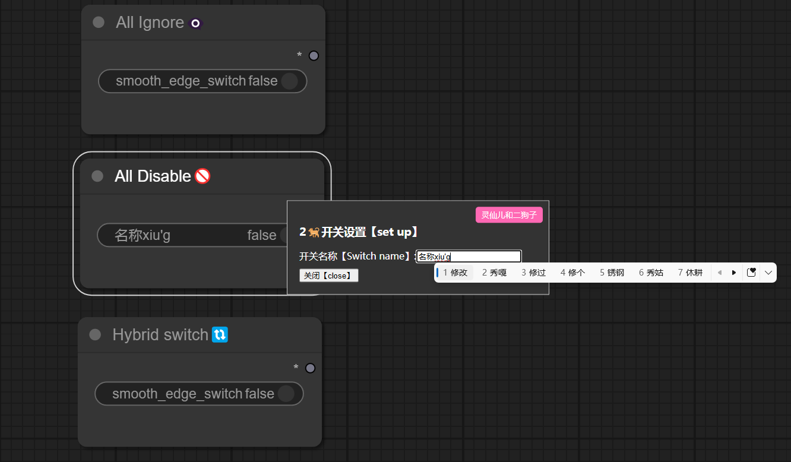    

## Functional Node: "Recursive switching🔀"
Takes N inputs and outputs the first non-null value. You can set the number of inputs to switch between and record the name of each input point.
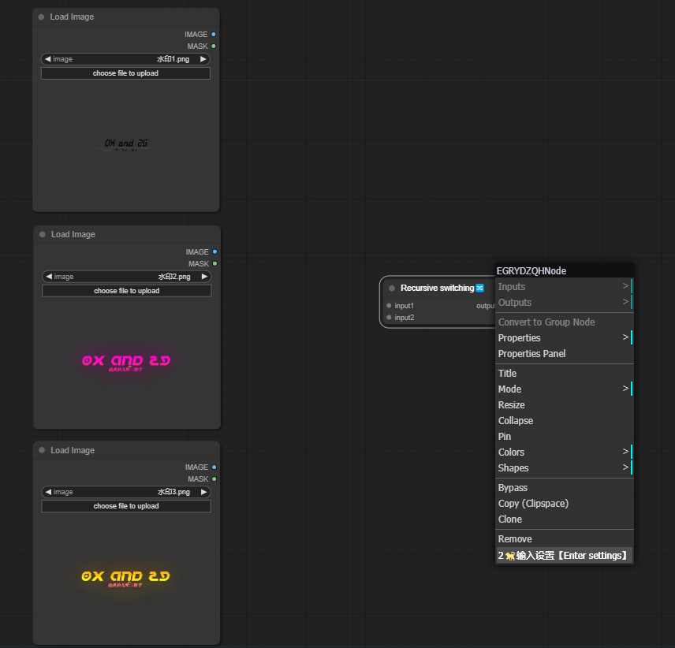    
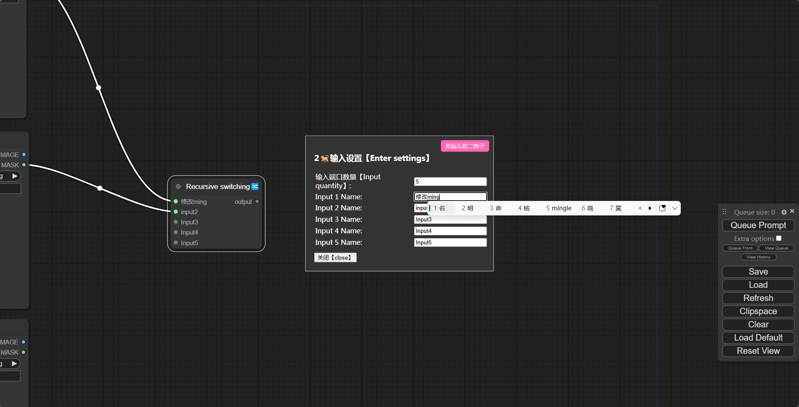    
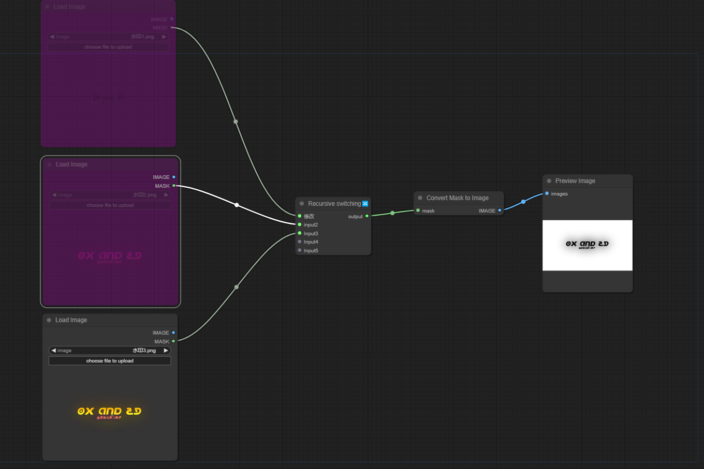    

## More Free SD Tutorials
Visit the Bilibili space of Lingxian'er and Er Gouzi:
[Lingxian'er & Er Gouzi's Bilibili Space](https://space.bilibili.com/19723588?spm_id_from=333.1007.0.0)   

Join our QQ channel by clicking here:
[Er Gouzi's QQ Channel](https://pd.qq.com/s/3d9ys5wpr)   


